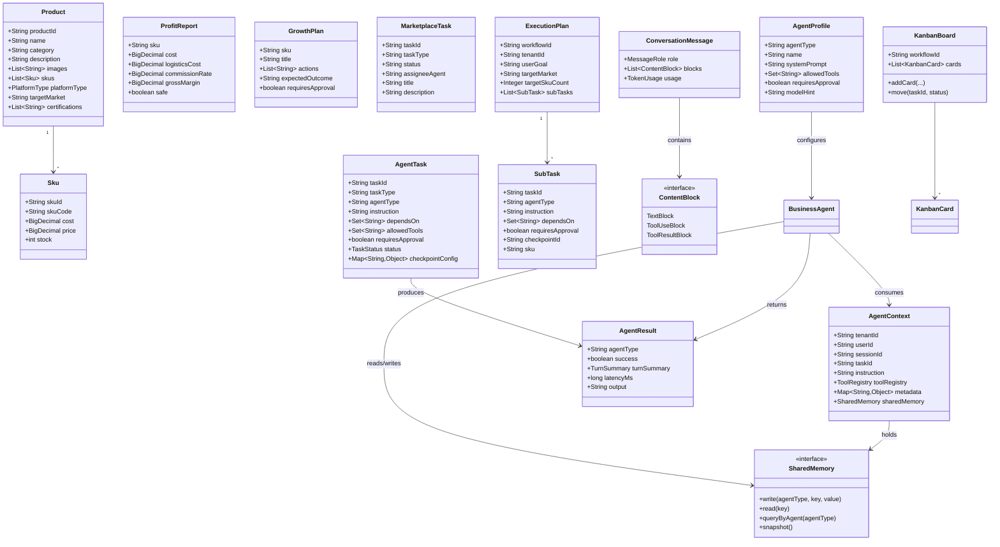
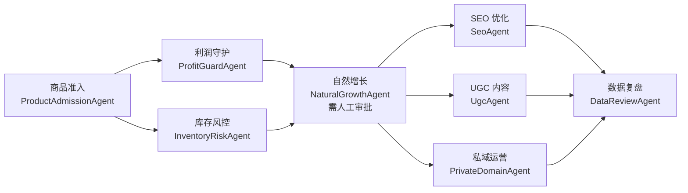
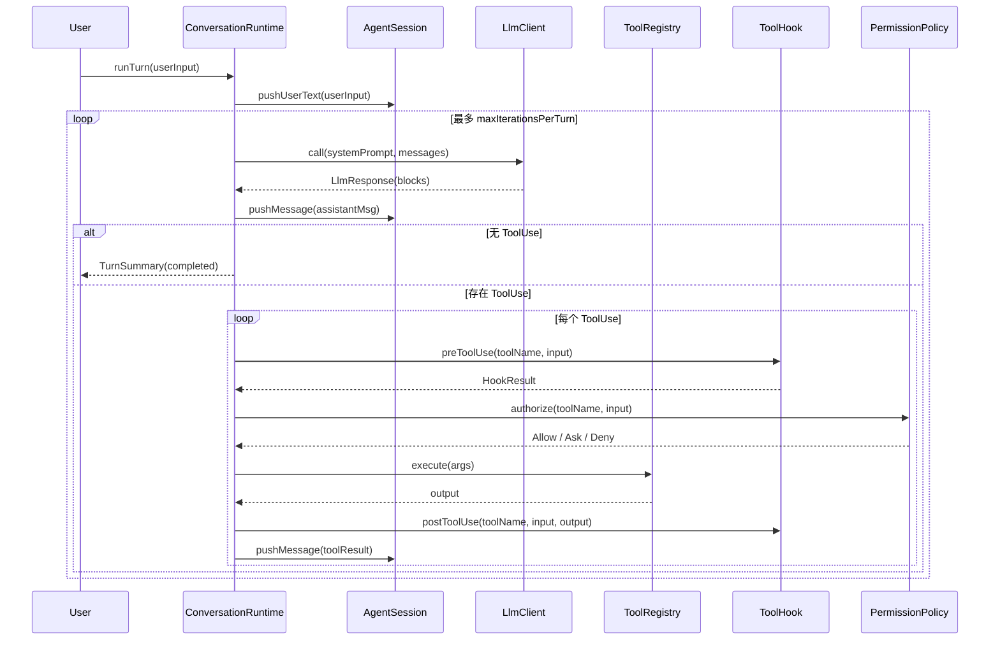
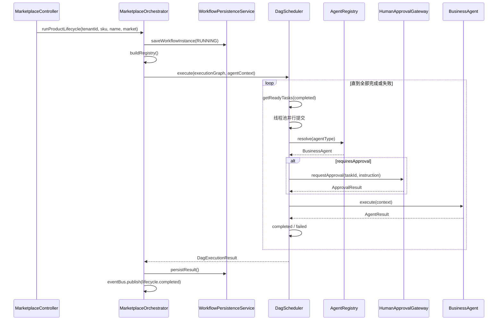
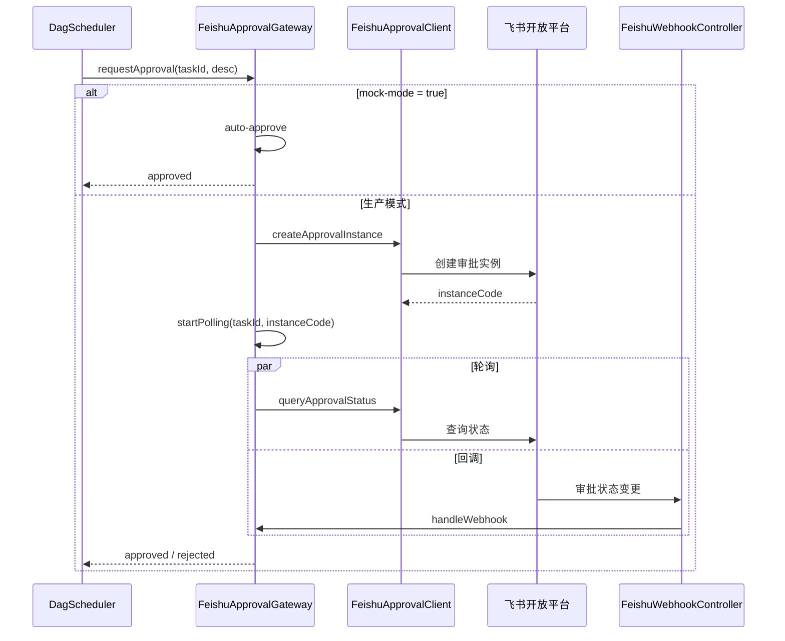
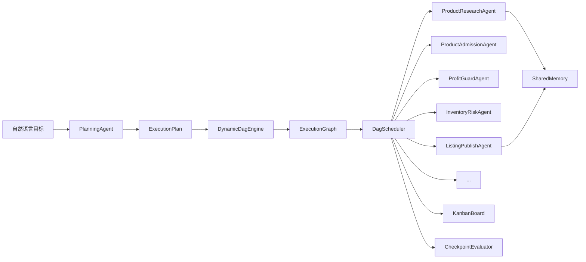

# Agent-OS 架构设计文档

> 版本：1.0.0-SNAPSHOT  
> 项目：`com.kuoge:agent-os` —— Multi-Agent Operating System for Cross-border E-commerce  
> 技术栈：Spring Boot 3.5.12 · Java 21 · Spring AI 2.0.0 (OpenAI) · JPA/H2 · Lombok

---

## 1. 系统解决的问题

Agent-OS 面向**跨境电商经营场景**，把围绕一款商品的完整经营闭环抽象为可编排、可执行、可观测的多 Agent 工作流。系统重点解决以下问题：

| 问题域 | 具体痛点 | Agent-OS 的解法 |
|---|---|---|
| **经营流程碎片化** | 准入、利润核算、库存风控、增长、SEO、UGC、私域、复盘等环节由不同系统或人工表格承载，难以串联 | 提供 DAG 编排器，将 8 个业务 Agent 串联成端到端的 `product-lifecycle` 工作流 |
| **LLM 与业务系统割裂** | 大模型只能给出文本建议，无法调用 ERP/OMS/BI 等真实业务系统 | 核心 ReAct 运行时 + Tool Registry，把业务服务 SPI 注册为 LLM 可调用的工具 |
| **多 Agent 协作无序** | 多个 Agent 并行执行时容易出现重复、冲突或依赖死锁 | DAG 调度器支持依赖声明、并行执行、失败重规划 |
| **高风险操作无人把控** | 价格调整、库存变更、营销投放等关键动作直接由 Agent 执行存在业务风险 | 权限策略 + 人工审批网关（飞书审批），实现人在回路 |
| **成本不可控** | LLM Token、调用次数、工具调用量缺乏统一计量 | UsageTracker 记录每次 LLM / Tool 调用与 Token 消耗 |
| **多租户数据隔离** | 平台需服务多个独立卖家/站点，数据不能串扰 | TenantContext ThreadLocal + 请求拦截器，工具执行时优先取上下文租户 |
| **可扩展性与可测试性** | 真实外部依赖（Psylos1、飞书）在开发/测试环境难以稳定联调 | 提供 Mock 实现与 Mock Mode 开关，支持分层测试 |

---

## 2. 架构分层图

```mermaid
flowchart TB
    subgraph 接入层["API / 接入层"]
        A[MarketplaceController<br/>商品生命周期工作流]
        B[FeishuWebhookController<br/>飞书审批回调]
        C[TenantInterceptor<br/>租户上下文注入]
    end

    subgraph 编排层["编排层 (Orchestration)"]
        D[MarketplaceOrchestrator<br/>经营编排器]
        E[DagScheduler<br/>DAG 并行调度器]
        F[AgentRegistry<br/>Agent 注册中心]
        G[HumanApprovalGateway<br/>人工审批抽象]
        H[EventBus<br/>事件总线]
        DDE[DynamicDagEngine<br/>动态 DAG 构建]
        APR[AgentProfileRegistry<br/>Agent Profile 注册中心]
        KB[KanbanBoard<br/>任务看板]
        CE[CheckpointEvaluator<br/>验证检查点]
    end

    subgraph 业务层["业务 Agent 层 (Business)"]
        I0[PlanningAgent<br/>意图识别与计划]
        I1[ProductResearchAgent<br/>选品研究]
        I2[ProductAdmissionAgent]
        I3[ProfitGuardAgent]
        I4[InventoryRiskAgent]
        I5[NaturalGrowthAgent]
        I6[SeoAgent]
        I7[UgcAgent]
        I8[PrivateDomainAgent]
        I9[ListingPublishAgent<br/>刊登发布]
        I10[DataReviewAgent]
        J[BaseBusinessAgent]
        K[MarketplaceToolFactory]
    end

    subgraph 核心引擎层["核心引擎层 (Core)"]
        L[ConversationRuntime<br/>ReAct 对话运行时]
        M[AgentSession / ConversationMessage<br/>会话与消息]
        N[ToolRegistry / Tool<br/>工具注册与执行]
        O[PermissionPolicy<br/>权限策略]
        P[ToolHook<br/>工具钩子]
        Q[UsageTracker / TokenUsage<br/>用量追踪]
        R[LlmClient / LlmResponse<br/>LLM 客户端抽象]
        SM[SharedMemory<br/>共享工作内存]
        AP[AgentProfile<br/>Agent 身份配置]
    end

    subgraph 基础设施层["基础设施层 (Infrastructure)"]
        S[ChatModelLlmAdapter<br/>Spring AI 适配器]
        T[WorkflowPersistenceService<br/>JPA 持久化]
        U[FeishuApprovalGateway<br/>飞书审批实现]
        V[Psylos1ApiClient + Services<br/>真实业务系统 SPI 实现]
        W[MockLlmClient / Mock Services<br/>Mock 实现]
        X[TenantContext<br/>租户上下文]
    end

    subgraph 外部依赖["外部依赖"]
        Y1[OpenAI / gpt-4o-mini]
        Y2[Feishu 开放平台]
        Y3[Psylos1 管理后台]
        Y4[H2 / RDBMS]
    end

    A --> D
    B --> U
    C --> X
    D --> E
    D --> F
    D --> G
    D --> H
    D --> K
    D --> DDE
    D --> APR
    D --> KB
    D --> SM
    DDE --> E
    E --> CE
    E --> KB
    E --> I0 & I1 & I2 & I3 & I4 & I5 & I6 & I7 & I8 & I9 & I10
    I0 & I1 & I2 & I3 & I4 & I5 & I6 & I7 & I8 & I9 & I10 --> J
    J --> L
    L --> M
    L --> N
    L --> O
    L --> P
    L --> Q
    L --> R
    L --> SM
    APR --> AP
    I0 & I1 & I2 & I3 & I4 & I5 & I6 & I7 & I8 & I9 & I10 --> SM
    K --> N
    R --> S --> Y1
    U --> Y2
    V --> Y3
    T --> Y4
    W -.-> L
    W -.-> K
```



### 分层说明

| 分层 | 职责 | 代表包 |
|---|---|---|
| **API 接入层** | 暴露 REST 接口、接收 Webhook、注入租户上下文 | `com.kuoge.agentos.api.*` |
| **编排层** | 定义经营闭环 DAG、调度 Agent 并行执行、人工审批、事件发布 | `com.kuoge.agentos.orchestration.*` |
| **业务 Agent 层** | 承载垂直领域 Agent 及其系统提示词、可用工具集；把业务服务 SPI 封装为工具 | `com.kuoge.agentos.business.*` |
| **核心引擎层** | 与业务无关的通用 Agent 运行时：ReAct 循环、会话、工具、权限、钩子、成本 | `com.kuoge.agentos.core.*` |
| **基础设施层** | 适配具体技术实现：Spring AI、JPA、飞书、Psylos1、Mock、租户上下文 | `com.kuoge.agentos.infrastructure.*` |
| **领域层** | 纯 POJO / Record，描述商品、SKU、利润报告、增长计划、任务等核心实体 | `com.kuoge.agentos.domain.*` |

---

## 3. 核心领域模型图



### 关键实体语义

- **Product / Sku**：跨境电商商品与规格，是工作流的输入主体。
- **ExecutionPlan / SubTask**：由 `PlanningAgent` 生成，描述用户目标如何拆分为子任务及依赖关系。
- **MarketplaceTask / AgentTask**：一次 DAG 执行中的原子任务，包含依赖、Agent 类型、所需工具、是否需审批、检查点配置。
- **AgentContext**：贯穿一次任务执行的上下文，承载租户、指令、工具注册表、元数据及共享内存。
- **AgentResult / TurnSummary**：Agent 执行结果，包含成功与否、ReAct 回合摘要、延迟、最终输出。
- **AgentProfile**：Agent 身份配置，定义系统提示词、工具白名单、审批策略与模型偏好。
- **SharedMemory**：Agent 间共享工作内存，支持跨 Agent 读取中间结果。
- **KanbanBoard / KanbanCard**：任务看板，记录工作流中各任务状态流转。
- **ConversationMessage / ContentBlock**：运行时内部的消息协议，支持文本、ToolUse、ToolResult 三种块。

---

## 4. 模块划分与职责边界

### 4.1 模块总览

| 模块 | 包路径 | 主要职责 |
|---|---|---|
| `api` | `com.kuoge.agentos.api` | 对外暴露 HTTP 接口：启动工作流、查询流程/任务/Kanban/内存、接收飞书审批回调 |
| `orchestration` | `com.kuoge.agentos.orchestration` | DAG 构建、并行调度、Agent 注册、人工审批抽象、事件发布、动态计划、Kanban、检查点 |
| `business` | `com.kuoge.agentos.business` | 领域 Agent 实现（含 PlanningAgent）、业务服务 SPI、工具工厂、Mock/Psylos1 实现 |
| `core` | `com.kuoge.agentos.core` | 通用 Agent 引擎：ReAct 运行时、会话、工具、权限、钩子、成本、LLM 抽象、共享内存、Agent Profile |
| `infrastructure` | `com.kuoge.agentos.infrastructure` | 第三方适配、持久化、租户上下文、Mock 辅助、核心 Bean 装配 |
| `domain` | `com.kuoge.agentos.domain` | 领域模型，无依赖，保持纯粹 |

### 4.2 各模块详细职责

#### core —— 通用 Agent 引擎

| 子包 | 类 | 职责 |
|---|---|---|
| `core.agent` | `BusinessAgent` / `AgentContext` / `AgentResult` | Agent 接口与执行上下文 |
| `core.agent.profile` | `AgentProfile` | Agent 身份配置：系统提示词、工具白名单、审批策略、模型偏好 |
| `core.runtime` | `ConversationRuntime` / `RuntimeConfig` / `TurnSummary` | ReAct 对话循环、回合控制、停止条件 |
| `core.session` | `AgentSession` / `ConversationMessage` / `ContentBlock` / `MessageRole` | 多轮会话状态、消息格式、ToolUse/ToolResult 配对校验 |
| `core.tool` | `Tool` / `ToolRegistry` | 工具接口、注册、作用域裁剪、Prompt 文本生成 |
| `core.permission` | `PermissionMode` / `PermissionPolicy` / `PermissionOutcome` | 危险操作识别、Allow / Ask / Deny 策略 |
| `core.hook` | `ToolHook` / `HookEvent` / `HookResult` | 工具调用前后扩展点，支持拦截/改写输入/标记失败 |
| `core.cost` | `UsageTracker` / `TokenUsage` | Token 与调用次数统计 |
| `core.client` | `LlmClient` / `LlmResponse` | LLM 客户端抽象，屏蔽底层模型差异 |
| `core.memory` | `SharedMemory` / `InMemorySharedMemory` / `MemoryEntry` | Agent 间共享工作内存 |

#### business —— 业务 Agent 与领域服务

| 子包 | 类 | 职责 |
|---|---|---|
| `business` | `BaseBusinessAgent` / 10+ 个领域 Agent（含 PlanningAgent、ProductResearchAgent、ListingPublishAgent） | 封装系统提示词与可用工具范围，调用 ReAct 运行时 |
| `business.service` | `ProductService` / `InventoryService` / `PricingService` / `MarketingService` / `AnalyticsService` / `OrderService` / `MarketResearchService` / `ListingService` | 业务服务 SPI（接口） |
| `business.service.mock` | `Mock*Service` | 本地开发与单测使用的 Mock 实现 |
| `business.service.psylos1` | `Psylos1*Service` / `Psylos1ApiClient` / `Psylos1Properties` | 真实 Psylos1 后台 API 适配实现 |
| `business.tool` | `MarketplaceToolFactory` | 将 SPI 实现注册为 `ToolRegistry`，并注入租户隔离逻辑 |

#### orchestration —— 工作流编排

| 类 | 职责 |
|---|---|
| `MarketplaceOrchestrator` | 编排入口：支持固定 `product-lifecycle` 与动态 `runGoal`，管理 SharedMemory / KanbanBoard |
| `PlanningAgent` | 意图识别 + 结构化执行计划生成 |
| `DynamicDagEngine` | 将 `ExecutionPlan` 动态转换为 `ExecutionGraph`，支持批量 SKU |
| `AgentProfileRegistry` | 管理所有 Agent Profile |
| `DagScheduler` | 基于依赖解析的并行调度器，集成检查点与 Kanban 更新 |
| `ExecutionGraph` / `AgentTask` | DAG 图结构与任务节点定义 |
| `AgentRegistry` | 按 `agentType` 查找并返回 `BusinessAgent` 实例 |
| `HumanApprovalGateway` | 人工审批抽象；`FeishuApprovalGateway` 提供飞书实现 |
| `EventBus` | 流程事件发布（如 `lifecycle.completed`、`goal.completed`） |
| `ReplanPolicy` | 失败重规划策略：`stopOnFailure` / `retryOnce` / `skipOnFailure` |
| `CheckpointEvaluator` / `ValidationResult` | 子 Agent 输出校验：规则 / LLM 评估 |
| `KanbanBoard` / `KanbanCard` | 任务看板，记录状态流转 |
| `ExecutionPlan` / `SubTask` | 结构化执行计划与原子子任务 |

#### infrastructure —— 技术与第三方适配

| 子包 | 类 | 职责 |
|---|---|---|
| `infrastructure.springai` | `ChatModelLlmAdapter` | 将 Spring AI `ChatModel` 适配为 `LlmClient` |
| `infrastructure.persistence` | `WorkflowPersistenceService` / `WorkflowInstanceEntity` / `TaskExecutionEntity` / Repository | JPA 持久化工作流与任务执行记录 |
| `infrastructure.feishu` | `FeishuApprovalGateway` / `FeishuApprovalClient` / `FeishuApprovalProperties` | 飞书审批创建、轮询、回调处理，支持 Mock 模式 |
| `infrastructure.tenant` | `TenantContext` / `TenantWebConfig` / `TenantInterceptor` | 多租户 ThreadLocal 与 Web 拦截器 |
| `infrastructure.config` | `AgentOsConfig` | 核心 Bean 装配（ToolRegistry、Orchestrator 等） |
| `infrastructure` | `MockLlmClient` | 单测/本地调试用的 LLM Mock |

#### api —— 接口层

| 类 | 职责 |
|---|---|
| `MarketplaceController` | `POST /api/v1/workflows/product-lifecycle` 固定工作流；`POST /goal` 动态目标工作流；查询工作流/任务/Kanban/内存 |
| `FeishuWebhookController` | `POST /webhook/feishu/approval` 处理飞书审批状态回调 |
| `TenantInterceptor` | 从请求头提取 `tenantId` 写入 `TenantContext` |

---

## 5. 核心流程

### 5.1 商品生命周期工作流（product-lifecycle）



流程说明：

1. **准入（Admission）**：校验商品资质、类目合规、图片素材。
2. **利润守护（Profit）**：并行于库存，计算成本、物流、佣金、毛利率。
3. **库存风控（Inventory）**：查询库存、预测需求。
4. **自然增长（Growth）**：生成 Listing 标题、关键词、博客选题；**关键节点需人工审批**。
5. **SEO / UGC / 私域**：基于增长计划并行展开。
6. **数据复盘（Review）**：聚合 GMV、流量、转化率，输出 7 天经营复盘。

### 5.2 ReAct 运行时单轮回合



### 5.3 DAG 调度执行流程



### 5.4 人工审批流程（飞书）



---

## 6. 关键技术设计

### 6.1 ReAct 运行时设计

- **循环控制**：每轮对话最多 `maxIterationsPerTurn` 次模型调用，防止无限循环。
- **回合控制**：单 Session 最多 `maxTurnsPerSession` 个用户回合。
- **消息协议**：使用 `ConversationMessage` + `ContentBlock` 统一文本、ToolUse、ToolResult。
- **ToolUse / ToolResult 配对校验**：`AgentSession.validateMessageOrder` 确保每个 ToolResult 都有前置的 Assistant ToolUse。
- **成本追踪**：`UsageTracker` 记录每次 LLM 调用的输入/输出 Token 与工具调用次数。

### 6.2 工具注册与作用域隔离

- `ToolRegistry` 支持全局注册与 `scoped(Set<String>)` 裁剪，确保每个 Agent 只能调用其被授权的工具。
- `MarketplaceToolFactory` 将业务服务 SPI（Product/Inventory/Pricing/Marketing/Analytics）映射为具名工具，例如 `verify_certification`、`query_cost`、`generate_title`。
- 工具入参使用 `Map<String, Object>`，便于 LLM 通过 JSON 调用。

### 6.3 多租户隔离

- `TenantContext` 基于 `ThreadLocal` 保存当前租户。
- `TenantInterceptor` 从 HTTP 请求头提取 `tenantId` 并注入上下文。
- `MarketplaceToolFactory` 在工具执行时优先读取 `TenantContext`，未命中则回退到工具参数 `tenantId`，实现业务数据隔离。

### 6.4 权限与安全

- `PermissionPolicy` 支持四种模式：`Allow`、`Prompt`、`WorkspaceWrite`、`DangerFullAccess`。
- 当前实现识别危险操作（如 `bash` 工具携带 `rm -rf`、`delete`、`drop`），对危险操作返回 `Ask` 要求人工确认。
- `ToolHook` 提供前置/后置扩展点，可用于审计、敏感信息脱敏、结果校验等。

### 6.5 人工审批网关

- `HumanApprovalGateway` 是审批抽象，当前提供 `FeishuApprovalGateway` 实现。
- 支持 **Mock 模式**（开发测试自动通过）、**飞书审批创建 + 轮询**、**飞书 Webhook 回调**三种模式。
- DAG 调度器对 `requiresApproval=true` 的任务会阻塞等待审批结果。

### 6.6 工作流持久化

- 使用 JPA + H2（可替换为 MySQL/PostgreSQL）。
- `WorkflowInstanceEntity` 记录工作流实例与状态。
- `TaskExecutionEntity` 记录每个 AgentTask 的执行结果、输出、延迟。
- `WorkflowPersistenceService` 在工作流启动、完成、异常时更新状态，实现可观测性。

### 6.7 LLM 适配

- `LlmClient` 是核心引擎的 LLM 抽象，屏蔽具体模型。
- `ChatModelLlmAdapter` 将 Spring AI 的 `ChatModel` 适配为 `LlmClient`，自动转换消息格式并提取 Token 用量。
- `MockLlmClient` 用于单元测试和本地调试，支持按关键词返回固定答案。

### 6.8 可扩展性设计

- **Agent 扩展**：实现 `BusinessAgent` 接口并在 `AgentRegistry` 注册即可接入编排。
- **工具扩展**：实现 `Tool` 接口并通过 `ToolRegistry.register` 注册。
- **服务 SPI 扩展**：`business.service` 定义接口，可新增 `Mock`、`Psylos1` 以外的实现（如 Shopify、Amazon SP-API）。
- **审批扩展**：实现 `HumanApprovalGateway` 可替换为钉钉、企业微信等审批系统。
- **持久化扩展**：Repository 基于 Spring Data JPA，切换数据库只需改配置。

---

## 7. 运行与接口示例

### 7.1 启动工作流

```bash
curl -X POST "http://localhost:8080/api/v1/workflows/product-lifecycle" \
  -H "X-Tenant-Id: tenant-1" \
  -d "tenantId=tenant-1" \
  -d "productSku=ORTH-LOAFER-US-08" \
  -d "productName=ORTH-LOAFER" \
  -d "targetMarket=US"
```

### 7.2 查询工作流

```bash
curl "http://localhost:8080/api/v1/workflows?tenantId=tenant-1" \
  -H "X-Tenant-Id: tenant-1"
```

### 7.3 查询任务明细

```bash
curl "http://localhost:8080/api/v1/workflows/wf-xxxx/tasks"
```

### 7.4 自然语言目标工作流（动态子 Agent）

```bash
curl -X POST "http://localhost:8080/api/v1/workflows/goal" \
  -H "X-Tenant-Id: tenant-1" \
  -d "tenantId=tenant-1" \
  -d "goal=本周给美国站自动选 20 个潜力 SKU 并上架"
```

### 7.5 查看 Kanban 看板

```bash
curl "http://localhost:8080/api/v1/workflows/wf-xxxx/kanban"
```

### 7.6 查看共享内存

```bash
curl "http://localhost:8080/api/v1/workflows/wf-xxxx/memory"
```

---

## 8. 动态多 Agent 扩展（Hermes / Claude Code 风格）

本节描述在原有固定 DAG 基础上新增的**意图识别 → 动态子 Agent 生成 → 批量 SKU 执行**能力。

### 8.1 新增问题域

| 问题域 | 解法 |
|---|---|
| 自然语言目标难以理解 | `PlanningAgent` 作为系统级 Orchestrator，解析目标并生成结构化 `ExecutionPlan` |
| 子 Agent 需要按需创建 | `DynamicDagEngine` 根据计划动态构建 DAG，`MarketplaceOrchestrator` 负责 spawn |
| Agent 间需要共享中间结果 | `SharedMemory` 共享工作内存，所有子 Agent 可读可写 |
| 任务状态需要可视化 | `KanbanBoard` 记录每个任务的状态流转 |
| 子 Agent 输出需要校验 | `CheckpointEvaluator` 在关键节点执行规则/LLM 验收 |
| Agent 配置需要统一管理 | `AgentProfileRegistry` 定义每个 Agent 的系统提示词、工具白名单、审批策略 |

### 8.2 动态编排架构



### 8.3 核心组件

| 组件 | 包 | 职责 |
|---|---|---|
| `PlanningAgent` | `business` | 意图识别 + 子 Agent 生成器 |
| `ExecutionPlan` / `SubTask` | `orchestration.plan` | 结构化执行计划 |
| `DynamicDagEngine` | `orchestration` | 计划转 DAG，支持批量 SKU |
| `AgentProfile` / `AgentProfileRegistry` | `core.agent.profile` / `orchestration` | Agent 身份与技能定义 |
| `SharedMemory` / `InMemorySharedMemory` | `core.memory` | Agent 间共享工作内存 |
| `KanbanBoard` / `KanbanCard` | `orchestration.kanban` | 任务看板 |
| `CheckpointEvaluator` / `ValidationResult` | `orchestration.checkpoint` | 验收检查点 |
| `ReplanPolicy` | `orchestration` | 失败重规划策略（STOP / RETRY / SKIP） |

### 8.4 子 Agent 创建条件

`PlanningAgent` 在以下情况下会创建子 Agent：

1. **目标涉及批量 SKU**：如“选品并上架 20 个 SKU”，生成 `ProductResearchAgent` + 每个 SKU 的后续任务；
2. **目标涉及多阶段经营闭环**：准入、利润、库存、增长、SEO、UGC、私域、复盘；
3. **某阶段输出需要独立校验**：自动插入 `CheckpointEvaluator`；
4. **任务需要人工审批**：如 `listing-publish`、`natural-growth`。

### 8.5 共享内存机制（借鉴 Hermes）

- 每个 workflow 创建一份 `InMemorySharedMemory`；
- Agent 通过 `AgentContext.sharedMemory()` 读写；
- 典型写入：
  - `product-research` 写入 `candidateSkus`；
  - `listing-publish` 写入 `published-{sku}`；
- 下游 Agent 可按 key 读取，无需重复调用外部系统。

### 8.6 Kanban 看板（借鉴 Hermes v0.12）

- 每个 workflow 创建一块 `KanbanBoard`；
- `DagScheduler` 在任务状态变化时更新卡片（PENDING → RUNNING → WAITING_APPROVAL → COMPLETED/FAILED）；
- 提供 `GET /{workflowId}/kanban` 查询。

### 8.7 验证检查点（借鉴 Hermes）

- 每个 `SubTask` 可声明 `checkpointId`；
- `CheckpointEvaluator` 支持规则校验（mustContain / mustNotContain）和 LLM 校验；
- 校验结果：`PASS` / `RETRY` / `SKIP` / `STOP`；
- 失败时由 `ReplanPolicy` 决定下一步。

### 8.8 Agent Profile（借鉴 Hermes / Claude Code）

- 每个 Agent 类型对应一个 `AgentProfile`；
- Profile 包含：名称、系统提示词、可用工具、是否需审批、模型偏好；
- 集中定义在 `AgentProfileRegistry` 和 `docs/AGENTS.md`。

### 8.9 新增服务 SPI

| SPI | 实现 | 工具 |
|---|---|---|
| `MarketResearchService` | `MockMarketResearchService` | `research_market`, `analyze_competition`, `score_product` |
| `ListingService` | `MockListingService` | `publish_listing`, `sync_images`, `update_inventory` |

---

## 9. 演进方向（可选）

- 引入持久化队列与状态机，支持工作流断点续跑。
- 将 `SharedMemory` 扩展为 Redis / 向量数据库，支持多实例与长期记忆。
- 接入真实电商平台 API（Amazon、Shopee、TikTok Shop）。
- 引入 RAG 商品知识库。
- 增加可视化 DAG 编辑与审批工作台。
- 支持 Agent Profile 热加载与技能市场。
